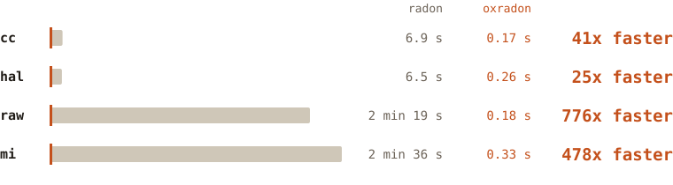

# oxradon

[](https://github.com/jsquared-labs/oxradon/actions/workflows/ci.yml)
[](https://crates.io/crates/oxradon)
[](https://pypi.org/project/oxradon/)
[](https://github.com/jsquared-labs/oxradon/blob/main/LICENSE)

oxradon is a Rust port of [radon](https://github.com/rubik/radon), Michele Lacchia's
code-metrics tool for Python. It takes the same commands and flags and prints the same output,
in a fraction of the time.

```console
$ oxradon cc -s -a src/
src/orders.py
    F 12:0 process_order - D (24)
    C 35:0 Cart - A (4)
    M 40:4 Cart.total - A (3)

3 blocks (classes, functions, methods) analyzed.
Average complexity: B (10.333333333333334)
```

## Features

- **Fast.** 25x to 776x faster than radon on real projects ([benchmark](#benchmark)).
- **Same output.** Your existing thresholds and scripts keep working ([compatibility](#compatibility)).
- **Same configuration.** Reads `radon.cfg`, `setup.cfg`, `pyproject.toml`, `~/.radon.cfg` and
  `RADONCFG`.
- **Doesn't give up.** Reports a file it can't read and moves on, in cases where radon stops.
- **No Python required.** One binary, also usable as a Rust library.

<picture>
  <source media="(prefers-color-scheme: dark)" srcset="https://raw.githubusercontent.com/jsquared-labs/oxradon/main/docs/bench-dark.svg">
  
</picture>

## Install

```bash
uv tool install oxradon      # or: pipx install oxradon, or: pip install oxradon
```

Prebuilt for Linux (x86-64 and ARM, including Alpine) and macOS (Apple silicon and Intel). There
is no Windows build. To try it once, run `uvx oxradon cc -s src/`. With Rust 1.97 or newer,
`cargo install oxradon` builds it from source.

Then run `oxradon` wherever you ran `radon`, for example `oxradon cc -nc -s src/`. The two can be
installed side by side.

## When to keep using radon

oxradon has all four of radon's commands (`cc`, `hal`, `raw`, `mi`) with all their flags, and
reads the same configuration files. Stay with radon if you:

- analyze Jupyter notebooks (oxradon accepts the notebook flags but skips notebooks);
- need `cc --xml`, `--md` or `--codeclimate`;
- import radon from Python;
- work on Windows.

## Compatibility

oxradon is checked against radon 6.0.1 on Python 3.14.10, on macOS and Linux. The test corpus
is the Python standard library plus eight popular packages: Django, SymPy, SQLAlchemy, Pydantic,
Rich, Black, FastAPI and httpx. Output was compared byte for byte:

| Command | Files compared | Differences |
|---|---|---|
| `cc` | 4,828 | 0 |
| `hal` | 5,697 | 0 |
| `raw` | 5,698 | 0 |
| `mi` | 5,697 | 0, apart from the wording of syntax errors |

radon's quirks are reproduced too. If you find a file where the two disagree, please open an
issue.

Two things vary by machine, for radon too. The last digit of an `mi` score depends on the
system's math library. A directory's files come out in the order the file system lists them.

### Where they differ

| Situation | radon | oxradon |
|---|---|---|
| `hal` on a file it can't read or parse | stops the whole run | reports the file and continues |
| Very deeply nested code | recursion error for that file | analyzes it |
| A file name containing `{` or `}` | crashes while printing it | prints it |
| Paths after an option (`hal a.py -f b.py`) | usage error | analyzes every path |
| `RADONFILESENCODING` | any Python codec | utf-8, utf-8-sig, latin-1, ascii and cp1252 only |
| `--exclude -1` (a value that looks like a negative number) | accepted | usage error; write `--exclude=-1` |
| Syntax error messages | Python's wording | Python's wording, or Ruff's for errors only the parser finds |
| `-O file` | writes color codes into the file | plain text unless `COLOR=yes` |
| `--help` | radon's help text | its own help text, same options |

[COMPATIBILITY.md](https://github.com/jsquared-labs/oxradon/blob/main/COMPATIBILITY.md) has the
rarer cases and how all this was tested.

## Benchmark

Measured with `scripts/bench.py` on an Apple M5 with 10 cores and a warm file cache. Each time is
the best of 7 runs, except radon's `hal`, `raw` and `mi`, which got 3. The script first checks that radon analyzed
every file. `hal` uses `-j` because radon's text output stops at the first file it can't parse.

| Command | Code analyzed | radon | oxradon | oxradon, 1 core |
|---|---|---|---|---|
| `cc -s` | CPython 3.14 stdlib (1,872 files) | 5.00 s | **90 ms** (56x) | 311 ms (16x) |
| `cc -s` | Third-party packages (3,824 files) | 6.89 s | **167 ms** (41x) | 482 ms (14x) |
| `hal -j` | stdlib | 3.96 s | **131 ms** (30x) | 350 ms (11x) |
| `hal -j` | Third-party packages | 6.55 s | **259 ms** (25x) | 653 ms (10x) |
| `raw -s` | stdlib | 32.1 s | **206 ms** (156x) | 500 ms (64x) |
| `raw -s` | Third-party packages | 139 s | **179 ms** (776x) | 771 ms (180x) |
| `mi -s` | stdlib | 38.1 s | **224 ms** (170x) | 957 ms (40x) |
| `mi -s` | Third-party packages | 156 s | **326 ms** (478x) | 1.52 s (103x) |
| any | One small file | 34-36 ms | **3 ms** (11-12x) | 3 ms (12-13x) |

`cc` and `hal` gain from Ruff's compiled parser and from using every core. `raw` and `mi` gain
much more. For each logical line, radon re-tokenizes a growing buffer, which is quadratic in long
statements. oxradon gets the same answers in one pass, so most of that gap is the algorithm, not
Rust. The one-file row is mostly Python's start-up time.

## Use as a library

Each command's analysis is a function that takes Python source as text:

```rust
let source = "def pick(x):\n    return x or 1\n";

let blocks = oxradon::cc::analyze(source, &oxradon::cc::Options::default())?;
assert_eq!(blocks[0].complexity(), 2);

let lines = oxradon::raw::analyze(source)?;
assert_eq!(lines.loc, 2);
```

`oxradon::hal::analyze` and `oxradon::mi::analyze` work the same way. `cargo doc --open` shows
the full API.

## Development

```bash
cargo test --no-fail-fast    # no Python needed: replays recordings made from radon and CPython
cargo clippy --all-targets
cargo fmt --check
cargo doc --no-deps
```

The scripts in `scripts/` compare oxradon with a real radon install.
[CONTRIBUTING.md](https://github.com/jsquared-labs/oxradon/blob/main/CONTRIBUTING.md) explains
the setup and what a change has to pass.

## How it was built

oxradon was written with AI coding assistants (Claude and Codex). Where radon's behavior was
unclear, the answer came from reading radon's and CPython's source instead of guessing from
examples.

## Credits and license

oxradon ports radon's algorithms and output formats. radon was written by Michele Lacchia and
its contributors; oxradon is independent of them and not affiliated. Parsing uses
[Ruff](https://github.com/astral-sh/ruff)'s Python parser, and the tokenizer, `tomllib` and
`fnmatch` are ported from CPython.

oxradon is MIT licensed, as is radon (© 2012-2017 Michele Lacchia). Both notices are in
[LICENSE](https://github.com/jsquared-labs/oxradon/blob/main/LICENSE).
